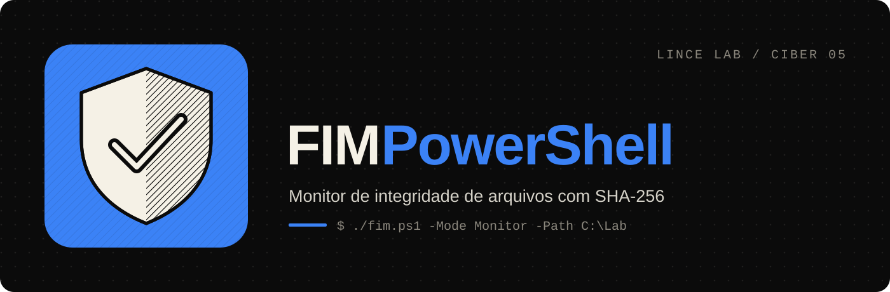
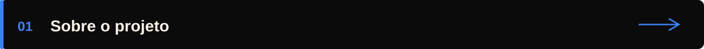
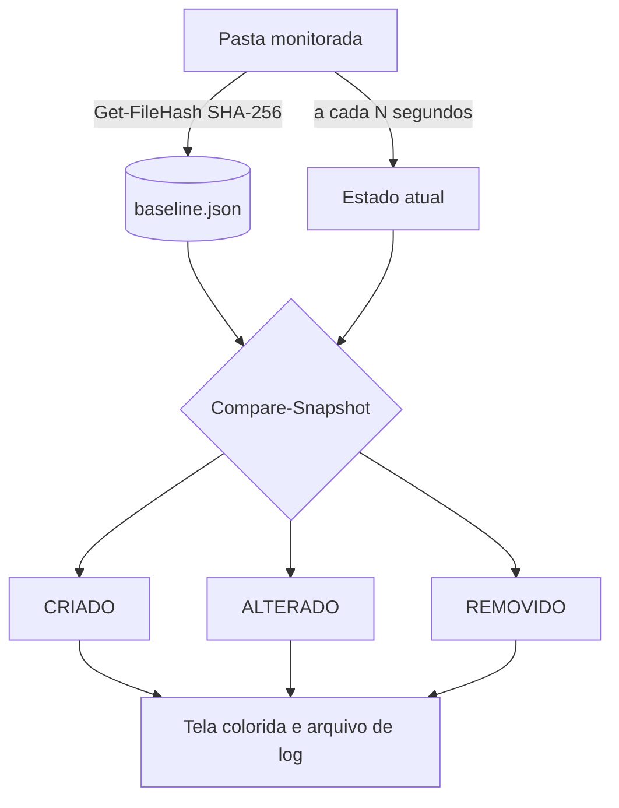
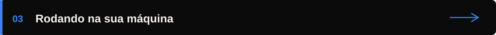
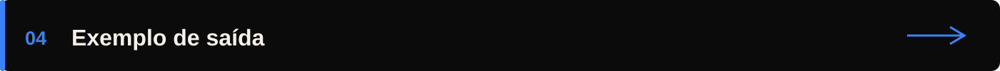
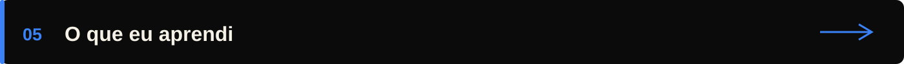
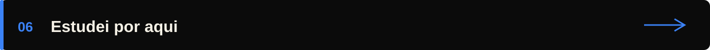

<a id="top"></a>

<p align="center"></p>

<p align="center">


<a href="https://github.com/arthurlynow098/fim-powershell/actions/workflows/testes.yml"></a>

</p>

<p align="center"><a href="#sobre">Sobre</a> &nbsp;&nbsp; <a href="#como-funciona">Como funciona</a> &nbsp;&nbsp; <a href="#rodando">Rodando</a> &nbsp;&nbsp; <a href="#aprendi">O que aprendi</a> &nbsp;&nbsp; <a href="#estudos">Estudos</a></p>

<a id="sobre"></a>

<p></p>

File Integrity Monitoring (FIM) é uma das primeiras coisas que aparecem quando você estuda SOC. A pergunta é simples, **algum arquivo importante mudou sem ninguém autorizar?** Um `web.config` alterado, um `.php` novo dentro da pasta do site ou um executável trocado são sinais clássicos de que alguém entrou onde não devia.

Ferramentas como Wazuh e Tripwire fazem isso em escala. Aqui eu construí a minha versão em PowerShell para entender a lógica por trás, já que no trabalho eu uso Windows o dia todo.

<a id="como-funciona"></a>

<p></p>



O projeto tem três modos

| Modo | O que faz |
|---|---|
| `Baseline` | Tira a "foto" da pasta, com o SHA-256 de cada arquivo, e salva em JSON |
| `Check` | Compara uma vez e sai com código 1 se tiver mudança, bom para agendar no Agendador de Tarefas |
| `Monitor` | Fica rodando e avisa em tempo real, sem repetir o mesmo alerta a cada ciclo |

Separei a lógica em um módulo (`FIM.psm1`) e deixei o `fim.ps1` só como interface. Isso foi o que permitiu escrever testes com Pester para cada função.

<a id="rodando"></a>

<p></p>

Funciona no Windows PowerShell 5.1, que já vem no Windows, e no PowerShell 7.

```powershell
git clone https://github.com/arthurlynow098/fim-powershell.git
cd fim-powershell

# 1. tira a foto da pasta
./fim.ps1 -Mode Baseline -Path C:\Lab

# 2. confere uma vez
./fim.ps1 -Mode Check -Path C:\Lab

# 3. ou fica monitorando a cada 5 segundos, gravando log
./fim.ps1 -Mode Monitor -Path C:\Lab -Interval 5 -LogFile fim.log
```

Se o Windows bloquear a execução de scripts, libere só para a sessão atual com `Set-ExecutionPolicy -Scope Process Bypass`.

Testes

```powershell
Install-Module Pester -MinimumVersion 5.5.0 -Scope CurrentUser
Invoke-Pester ./tests -Output Detailed
```

<p></p>

Criei a baseline, depois mudei a porta no `config.ini`, apaguei o `leia-me.txt` e criei um `shell.php`, simulando o que um invasor faria num servidor web.

```text
  baseline criada com 3 arquivo(s) em baseline.json

  3 mudança(s) desde a baseline

  2026-11-15T07:19:39 ALTERADO  config.ini
  2026-11-15T07:19:39 CRIADO    shell.php
  2026-11-15T07:19:39 REMOVIDO  leia-me.txt
```

<a id="aprendi"></a>

<p></p>

- Por que hash é a forma certa de detectar alteração (data de modificação pode ser falsificada)
- Organizar PowerShell em módulo com funções exportadas
- Escrever teste com Pester e rodar no GitHub Actions em uma máquina Windows
- O detalhe de encoding do PowerShell 5.1, que precisa de UTF-8 com BOM para mostrar acento
- Como o FIM aparece em normas como PCI DSS e em ferramentas como o Wazuh

Próximos passos

- [ ] Usar `FileSystemWatcher` para reagir na hora em vez de checar por intervalo
- [ ] Mandar o alerta para o Visualizador de Eventos do Windows
- [ ] Assinar a baseline para ninguém conseguir editar ela junto com o ataque

<a id="estudos"></a>

<p></p>

Segui essas aulas e materiais para entender e aplicar tudo que está aqui.

| Material | O que tirei dele |
|---|---|
| [Microsoft Learn, PowerShell 101](https://learn.microsoft.com/en-us/powershell/scripting/learn/ps101/00-introduction) | Base de PowerShell, pipeline e objetos |
| [Documentação do Get-FileHash](https://learn.microsoft.com/en-us/powershell/module/microsoft.powershell.utility/get-filehash) | Cálculo de SHA-256 de arquivos |
| [Wazuh, File Integrity Monitoring](https://documentation.wazuh.com/current/user-manual/capabilities/file-integrity/index.html) | Como uma ferramenta profissional resolve o mesmo problema |
| [MITRE ATT&CK T1565.001, Stored Data Manipulation](https://attack.mitre.org/techniques/T1565/001/) | O tipo de ataque que o FIM ajuda a pegar |
| [Pester, Quick Start](https://pester.dev/docs/quick-start) | Estrutura de testes com Describe, It e Should |

<p align="center"><sub>Parte do <a href="https://github.com/arthurlynow098">Lince Lab</a>, minha coleção de projetos de cibersegurança</sub></p>

<p align="center"><a href="#top">Voltar ao topo</a></p>
