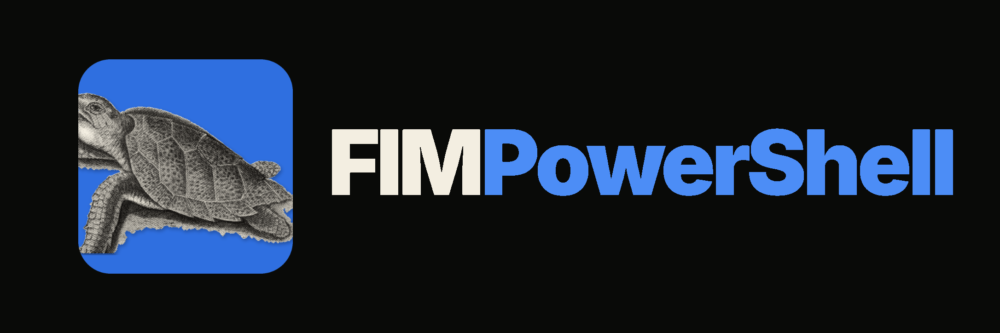
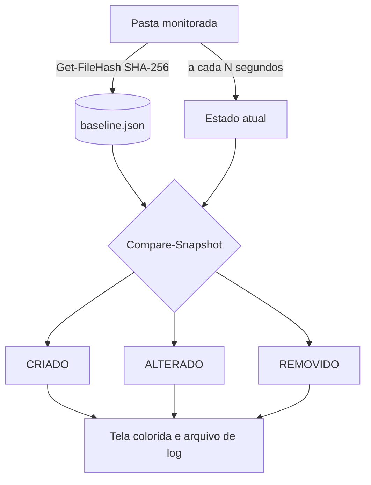

<p align="center"><sub>FIM PowerShell</sub></p>

---

<p align="center">
  
</p>

<p align="center">
  Monitor de integridade de arquivos (FIM) em PowerShell com baseline SHA-256 e testes Pester
</p>

<p align="center">
  
  
  <a href="https://github.com/arthurlynow098/fim-powershell/actions/workflows/testes.yml"></a>
  
</p>

## Sobre o projeto

File Integrity Monitoring (FIM) é uma das primeiras coisas que aparecem quando você estuda SOC. A pergunta é simples, **algum arquivo importante mudou sem ninguém autorizar?** Um `web.config` alterado, um `.php` novo dentro da pasta do site ou um executável trocado são sinais clássicos de que alguém entrou onde não devia.

Ferramentas como Wazuh e Tripwire fazem isso em escala. Aqui eu construí a minha versão em PowerShell para entender a lógica por trás, já que no trabalho eu uso Windows o dia todo.

## Como funciona



## Tecnologias

<p>
  
  
  
</p>

## Executando o código

Funciona no Windows PowerShell 5.1, que já vem no Windows, e no PowerShell 7.

```powershell
git clone https://github.com/arthurlynow098/fim-powershell.git
cd fim-powershell

# 1. tira a foto da pasta
./fim.ps1 -Mode Baseline -Path C:\Lab

# 2. confere uma vez
./fim.ps1 -Mode Check -Path C:\Lab

# 3. ou fica monitorando a cada 5 segundos, gravando log
./fim.ps1 -Mode Monitor -Path C:\Lab -Interval 5 -LogFile fim.log
```

Se o Windows bloquear a execução de scripts, libere só para a sessão atual com `Set-ExecutionPolicy -Scope Process Bypass`.

Testes

```powershell
Install-Module Pester -MinimumVersion 5.5.0 -Scope CurrentUser
Invoke-Pester ./tests -Output Detailed
```

## Exemplo

Criei a baseline, depois mudei a porta no `config.ini`, apaguei o `leia-me.txt` e criei um `shell.php`, simulando o que um invasor faria num servidor web.

```text
  baseline criada com 3 arquivo(s) em baseline.json

  3 mudança(s) desde a baseline

  2026-11-15T07:19:39 ALTERADO  config.ini
  2026-11-15T07:19:39 CRIADO    shell.php
  2026-11-15T07:19:39 REMOVIDO  leia-me.txt
```

## Estudei por aqui

Segui essas aulas e materiais para entender e aplicar tudo que está aqui.

| Material | O que tirei dele |
|---|---|
| [Microsoft Learn, PowerShell 101](https://learn.microsoft.com/en-us/powershell/scripting/learn/ps101/00-introduction) | Base de PowerShell, pipeline e objetos |
| [Documentação do Get-FileHash](https://learn.microsoft.com/en-us/powershell/module/microsoft.powershell.utility/get-filehash) | Cálculo de SHA-256 de arquivos |
| [Wazuh, File Integrity Monitoring](https://documentation.wazuh.com/current/user-manual/capabilities/file-integrity/index.html) | Como uma ferramenta profissional resolve o mesmo problema |
| [MITRE ATT&CK T1565.001, Stored Data Manipulation](https://attack.mitre.org/techniques/T1565/001/) | O tipo de ataque que o FIM ajuda a pegar |
| [Pester, Quick Start](https://pester.dev/docs/quick-start) | Estrutura de testes com Describe, It e Should |

## Licença

Distribuído sob a licença MIT. Veja o arquivo [LICENSE](LICENSE).

<p align="center"><sub>A gravura do banner é a tartaruga de Mark Catesby, do século XVIII, em domínio público no <a href="https://commons.wikimedia.org/wiki/File%3AMark_Catesby%2C_The_Hawks-bill_Turtle_%28Testudo_caretta%29%2C_published_1731-1743%2C_NGA_73663.jpg">Wikimedia Commons</a>.</sub></p>
